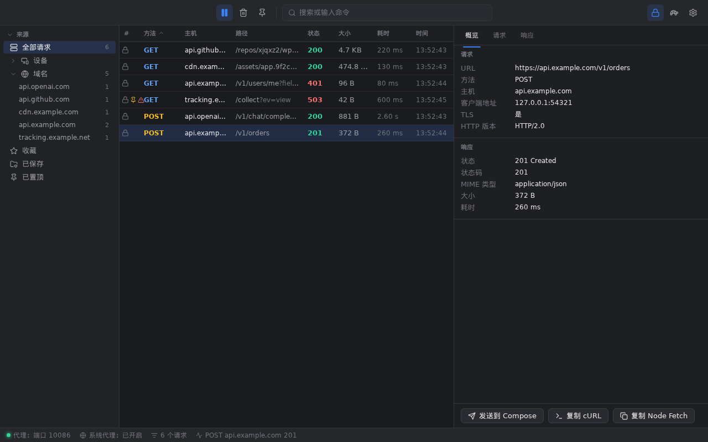
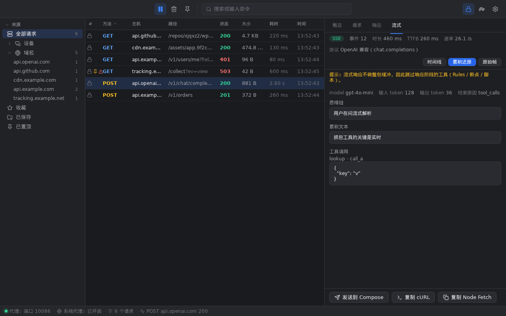
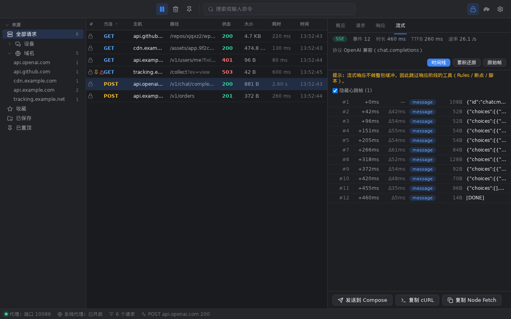
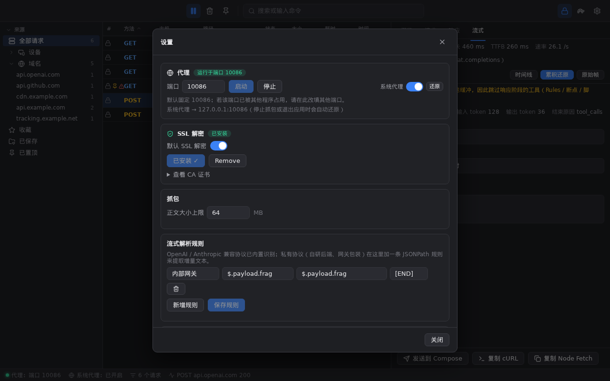
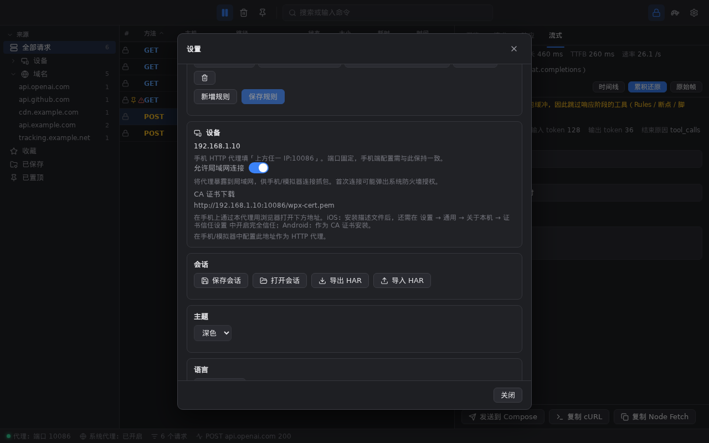

# WProxyman

一款跨平台（Windows / macOS / Linux）的 **HTTP / HTTPS 抓包调试代理**。界面与交互参考 Proxyman，
支持 HTTPS 解密、HTTP/2、WebSocket、**SSE / LLM 流式响应的逐条还原**，以及 Map Local、断点、
脚本等常用调试工具，帮助你查看、分析、修改应用的网络请求。



---

## 30 秒跑起来

1. 从 [Releases](https://github.com/xjqxz2/wproxyman/releases) 下载对应平台的包
   （Windows `.exe` / macOS `.dmg` / Linux `.tar.gz` `.deb` `.rpm`）；
2. 打开应用 —— **自动开始抓包并接管系统代理**（代理端口固定为 `10086`）；
3. 刷新浏览器或打开任意 App，流量立刻出现在列表里。

> 抓包期间浏览器会自动禁用 HTTP/3（QUIC 无法走 HTTP 代理），流量以 HTTP/1.1 / HTTP/2 呈现
> 并完整解密 —— 这是行业标准行为（Charles / Proxyman 相同）。

### macOS 首次打开被拦截？

应用未通过 Apple 公证，Gatekeeper 会提示"无法验证开发者"。按 macOS 版本选一种方式：

- **macOS 15 (Sequoia) 及以上**：先双击一次应用 → 打开 **系统设置 → 隐私与安全性**，
  在"安全性"区域点 **仍要打开**，再输入密码；
- **macOS 14 及以下**：右键（或按住 Control）点击 `WProxyman.app` → **打开**；
- 或者直接清掉隔离属性（终端）：

  ```bash
  xattr -dr com.apple.quarantine /Applications/WProxyman.app
  ```

---

## 怎么用（一条主线）

### 1. 抓到 HTTPS 明文

抓 HTTPS 需要安装并信任本地 CA：

1. 工具栏 **⚙ 设置 → SSL 解密 → 安装证书**；
   - Windows 静默装进用户根存储；
   - macOS / Linux 会走系统授权流程（输入密码）；
2. 装好后 HTTPS 自动解密。证书没被信任时，对应域名的 HTTPS **自动降级为隧道直通**，
   不会让流量中断（只是看不到明文）。

### 2. 看内容

- 列表里逐条显示方法、主机、路径、状态、大小、耗时、时间；点任意一条看详情；
- 详情分 **概览 / 请求 / 响应 / 流式**（流式响应才有）四个标签页；
- 请求与响应都支持 Headers、JSON/XML 自动格式化、原始视图；
- 图片 / 音频 / PDF 直接预览，二进制用 hex 视图，任意响应可 **Save to file** 落盘。

### 3. 改内容（即时生效，不需要重启）

| 想做的事 | 用哪个工具 |
|---|---|
| 把接口换成本地文件 / 假数据 | **Map Local** |
| 把请求转发到另一个环境（测试 → 预发） | **Map Remote** |
| 直接掐掉某个埋点 / 广告请求 | **Block List** |
| 只放行白名单域名，其余全断 | **Allow List** |
| 暂停请求或响应、手改内容再放行 | **Breakpoints** |
| 用 JS 脚本改请求/响应（含取消请求） | **Scripting** |
| 模拟弱网（限速 / 延迟 / 丢包） | **Network Conditions** |
| 批量改 Header、替换正文、重定向 | **Rules** |
| 禁用缓存，强制拿最新内容 | **No Caching** |
| 转发到 Burp / Fiddler 继续分析 | **External Proxy** |

### 4. 重放与导出

- **Repeater**：选中一条流量改完重发；**Compose**：从零构造请求（支持粘贴 cURL 导入）；
- 任意流量一键生成 **cURL / Node-fetch / Postman** 代码；
- 会话可保存为 `.wpx`（随时打开继续看），也可 **HAR 导入/导出**与 Charles、Fiddler 互通。

### 5. 调 LLM / 流式接口

流式响应（`text/event-stream`、NDJSON）**不做整包缓冲**：客户端逐 token 收到，界面同步逐条出现。
详情页的 **流式** 标签页提供三个视图：



- **时间线**：每条事件的序号、相对时间、与上一条的间隔、大小、event 名与内容预览，
  可一键隐藏心跳帧（`: ping` 这类注释行）；

  

- **累积还原**：把增量碎片拼成完整回复 —— 内置识别
  **OpenAI 兼容**（`chat.completions` / `responses`，含 `reasoning_content`、`tool_calls`
  参数分片拼接、`usage`）与 **Anthropic 兼容**（`messages`，含 `thinking_delta`、
  `tool_use` 的 `input_json_delta` 拼回 JSON）；自建的 OpenAI 兼容服务（vLLM / Ollama /
  one-api 等）同样能识别，因为判定依据是**报文结构**而不是域名；
- **原始帧**：累计正文（受"正文大小上限"约束）。

顶部还会显示 **TTFB**（首个字节耗时）与事件速率，用来判断"卡在哪一段"。

**私有协议怎么办？** 在 **设置 → 流式解析规则** 里加一条 JSONPath 规则即可，
不需要等我们适配：



| 字段 | 含义 | 例子 |
|---|---|---|
| 名称 | 规则名（界面显示） | `内部网关` |
| 匹配路径 | 可选：命中该路径才应用本规则 | `$.payload.frag` |
| 增量路径 | 提取增量文本的路径 | `$.choices[0].delta.content` |
| 结束值 | 可选：遇到该值停止累积 | `[DONE]` |

> 注意：流式响应无法在转发前"整包改写"，因此会**跳过响应阶段的工具**
> （Rules / 断点 / 脚本）。Stream 页顶部会明确提示这一点。

---

## 手机 / 模拟器抓包



1. **设置 → 设备**，查看本机局域网 IP；
2. 打开 **允许局域网连接**（代理监听 `0.0.0.0`）。首次连接时系统可能弹防火墙授权，请放行；
3. 手机连同一个 Wi-Fi，把 HTTP 代理指向 `电脑IP:10086`；
   - **端口固定 10086**，可在 设置 → 代理 中修改；改完手机上的配置要同步改；
4. 装抓包证书（抓 HTTPS 必需）：手机浏览器打开 `http://电脑IP:10086/wpx-cert.pem`，
   或先访问 `http://电脑IP:10086/wpx-cert` 看分步引导页；
   - **iOS**：下载描述文件后 → 设置 → 通用 → VPN 与设备管理 → 安装 → 再到
     设置 → 通用 → 关于本机 → **证书信任设置** 里开启完全信任；
   - **Android**：设置 → 安全 → 加密与凭据 → 安装证书 → CA 证书；
5. 完成后手机上的 HTTPS 即可被解密抓包。

---

## 功能一览

| 能力 | 说明 |
|---|---|
| 🔓 **HTTPS 解密** | 本地 CA 动态签发域名证书；可按域名单独开关；证书未信任时自动降级为隧道 |
| ⚡ **HTTP/2** | 完整解析多路复用流量 |
| 🔌 **WebSocket** | 帧级双向中继与消息记录（文本 / 二进制 / 控制帧） |
| 🌊 **流式响应** | SSE / NDJSON 逐块透传 + 时间线 + LLM 累积还原（见上） |
| 🧰 **调试工具** | Map Local / Map Remote / Block List / Allow List / 断点 / 脚本 / 限速 / Rules / 外部代理 / No Caching / Compose / Repeater |
| 📦 **内容查看** | JSON / XML 格式化、图片音频 PDF 预览、hex 视图、一键保存 |
| 🔍 **搜索过滤** | 十万级流量虚拟滚动、按域名与方法/状态过滤、全文搜索 |
| 💾 **会话与导出** | `.wpx` 会话、HAR 导入导出、cURL 导入、cURL / Node-fetch / Postman 生成 |
| 🌐 **界面** | 简体中文 / English，深色 / 浅色主题 |
| 📱 **设备接入** | 局域网抓包、内置证书下载与引导页 |

---

## 设置项说明

- **代理**：端口（默认固定 `10086`，可修改；被占用时启动会失败并提示换端口）、启动/停止、
  系统代理开关（旁边有 **还原** 按钮作为应急出口）；
- **SSL 解密**：全局开关、按域名开关、证书安装/移除/查看；
- **抓包**：正文大小上限（默认 64 MB，超出部分不影响转发，只是不再保存）；
- **流式解析规则**：非标 SSE / NDJSON 的自定义 JSONPath 规则（见上）；
- **外观**：深色 / 浅色、中文 / English。

**关于系统代理**：抓包时会接管系统代理；**停止抓包或退出应用时会自动还原**，
不会把你的机器留在"指向一个已经关闭的端口"的状态（那会导致整机断网）。
如果因为异常退出仍有残留，设置 → 代理 → **还原** 一键恢复直连。

---

## 常见问题

**抓不到 HTTPS，只看到 CONNECT 隧道？**
证书没被信任。Windows 重装一次证书；macOS 检查"钥匙串访问"里的 WProxyman CA 是否被信任；
手机需要额外开启"完全信任"（iOS）或作为 CA 证书安装（Android）。

**手机连不上代理？**
① 确认已打开 **允许局域网连接**；② 手机与电脑在同一网段；③ 系统防火墙放行 WProxyman
（首次连接会弹授权）；④ 确认端口一致（默认 10086）。

**退出应用后电脑没网了？**
v1.0.7 起停止抓包与退出都会自动还原系统代理。若你用的是更早版本，或遇到过异常退出：
设置 → 代理 → **还原**。也可以手动检查系统代理设置是否还指向 `127.0.0.1:10086`。

**提示"端口 10086 无法使用"？**
被别的程序占用了。设置 → 代理 里改一个端口（比如 10086 → 10087），启动后记得同步手机配置。

**为什么抓不到 HTTP/3 (QUIC) 的流量？**
HTTP/3 走 UDP，不走 HTTP 代理。抓包期间浏览器会自动回退到 HTTP/1.1 / HTTP/2，
所以流量仍然完整可见 —— 这一点与 Charles / Proxyman 一致。

**LLM 流式回复在"累积还原"里是空的？**
说明它的协议不是 OpenAI / Anthropic 兼容格式。在 Stream 页看几条原始帧，找到增量文本所在的
字段，然后到 设置 → 流式解析规则 加一条 JSONPath 规则。

---

## 安装与平台要求

| 平台 | 架构 | 产物 | 说明 |
|---|---|---|---|
| Windows | x64 / ARM64 | `.exe` | 需要 WebView2 运行时（Win10/11 通常已内置） |
| macOS | Apple Silicon / Intel | `.dmg` | 未公证，首次打开见上文 |
| Linux | x64 | `.deb` / `.rpm` / `.tar.gz` | 需要 GTK3 与 WebKitGTK 运行时（主流桌面发行版通常已具备） |

```bash
# Debian / Ubuntu
sudo dpkg -i wproxyman_<版本>_amd64.deb
# Fedora / RHEL
sudo rpm -i wproxyman-<版本>-1.x86_64.rpm
# 通用
tar xzf wproxyman_<版本>_linux_amd64.tar.gz && ./WProxyman
```

### 从源码构建

需要 Go 1.25+、Node 22+ 与 [Wails CLI](https://wails.io)：

```bash
go install github.com/wailsapp/wails/v2/cmd/wails@latest
make deps      # 安装前后端依赖
make build     # 产物在 build/bin/
make test      # Go 测试 + 前端类型检查
```

---

## 已知限制

- **未做 Apple 公证**：macOS 首次打开需要手动放行（见上），后续版本同样需要；
- **HTTP/3 (QUIC)** 不支持：UDP 流量无法通过 HTTP 代理抓取；
- **上游代理不支持 SOCKS5**：目前支持 HTTP / HTTPS 上游；
- **Diff 工具尚未实现**：工具列表里有入口，但当前只是占位页；
- **侧栏的"设备 / 已保存"暂不参与筛选**：设备维度归类仍在开发中，界面已预留；
- 流式响应会跳过响应阶段的工具（Rules / 断点 / 脚本），原因见上文。

---

## 许可

[Apache License 2.0](LICENSE)
